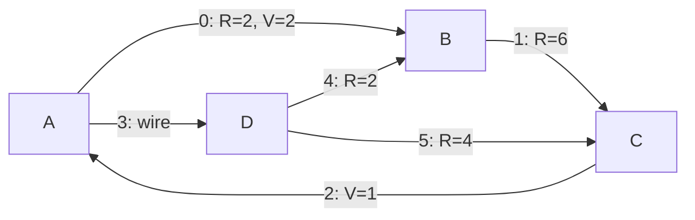

# Electrical Circuit Code Example

This document shows how to use `TMMSolver` for a branched system — a DC electrical circuit —
with the presets from `tmm_kit.electrical`.

The same approach works for any other branched system (e.g., pipeline networks):
define your own elements, nodes and boundary conditions by subclassing `TMMElement` and `TMMNode`
and building `TMMEquation`s (see `docs/tmm/transfer_matrix_method.md`).

## Circuit Model

The circuit is a directed graph:
- **elements** are the branches between nodes. A branch may contain a resistor $R$ and a voltage source $V$.
  The element direction (start → end) is the positive direction of the current;
- **nodes** are the junctions where branches meet.

The element state is $\vec{Y} = (E, I)^T$ — potential and current (`STATE_E`, `STATE_I`).
Its transfer equation:

$$E_e = E_0 - R I_0 + V, \qquad I_e = I_0$$

The node conjugation equations:
- all connected element edges have equal potentials $E$;
- Kirchhoff's current law: the sum of inbound currents equals the sum of outbound currents.

## Example

The circuit has 4 nodes (A, B, C, D) and 6 elements:



Elements are defined by their resistance and voltage. The element `length` doesn't affect
electrical elements, but it is required by the `TMMElement` base class:

```python
import tmm_kit.electrical as el
from tmm_kit import ElementEdge, TMMSolver

elements = [
    el.ElectricalElement(length=1, resistance=2, voltage=2),  # 0: A -> B
    el.ElectricalElement(length=1, resistance=6, voltage=0),  # 1: B -> C
    el.ElectricalElement(length=1, resistance=0, voltage=1),  # 2: C -> A
    el.ElectricalElement(length=1, resistance=0, voltage=0),  # 3: A -> D
    el.ElectricalElement(length=1, resistance=2, voltage=0),  # 4: D -> B
    el.ElectricalElement(length=1, resistance=4, voltage=0),  # 5: D -> C
]
```

Nodes reference elements by their indices. Note that only 3 of the 4 nodes are defined here:

```python
nodes = [
    el.ElectricalNode(inbound_elements=[2], outbound_elements=[0, 3]),  # A
    el.ElectricalNode(inbound_elements=[0, 4], outbound_elements=[1]),  # B
    el.ElectricalNode(inbound_elements=[1, 5], outbound_elements=[2]),  # C
]
```

The last node (D) is replaced by boundary conditions. If all nodes were defined, the system would be singular:
- potentials are defined only up to a constant, so the absolute potential level has to be fixed somewhere;
- the current law of the last node follows from the current laws of all the other nodes.

So instead of the node D equations, the potential of every element edge connected to D is fixed:

```python
bcs = el.electrical_circuit_boundary_node(
    inbound_elements=[3],
    outbound_elements=[4, 5],
    fixed_potential=1,
)
```

The number of equations now equals the number of unknowns $2 \cdot 6 \cdot 2 = 24$:
12 transfer equations, 9 node conjugation equations (one per connected element edge) and 3 boundary conditions.

## Solving

```python
solver = TMMSolver(el.ELECTRICAL_STATE_SIZE, elements, nodes, bcs)
result = solver.solve()

# States at the start and at the end of every element, shape (6, 2)
start_states = result.get_all_edge_states(ElementEdge.START)
end_states = result.get_all_edge_states(ElementEdge.END)

currents = start_states[:, el.STATE_I]
# [ 0.643  0.286  0.536 -0.107 -0.357  0.25 ]

potentials = end_states[:, el.STATE_E]
# [1.714  0.     1.     1.     1.714  0.   ]
```

A negative current means it flows against the element direction (e.g., in the wire 3 it flows from D to A).

The state of a single element edge can be retrieved too:

```python
result.get_edge_state(0, ElementEdge.END)
# [1.714 0.643]  (E, I)
```
